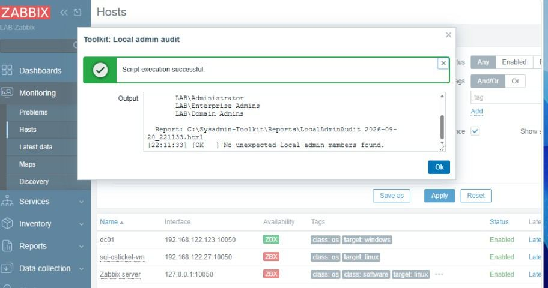

# Sysadmin-Toolkit

**Eén PowerShell-kit voor het dagelijkse werk van een Windows-systeembeheerder — van nieuwe pc tot AD-gezondheidscheck en Windows Update-beheer, in één menu of stuk voor stuk.**

Een verzameling kant-en-klare PowerShell-scripts (Windows PowerShell 5.1) voor een typische hybride Microsoft-omgeving: Windows 10/11-werkplekken, on-prem Active Directory, Entra ID + Intune in de cloud, en Zabbix-monitoring. Gebouwd en getest in een eigen lab op een echte Windows Server 2025-domeincontroller, een Windows 11-machine en een Zabbix 7.0-server.

> **Versie 1.5.9 · 21 secties · 64 scripts · installer (.exe) + ISO · draait ook vanaf USB zonder installatie.**

*Dubbelklik op de setup: de kit wordt naar `C:\Sysadmin-Toolkit` gezet, bestanden worden gedeblokkeerd, een snelkoppeling verschijnt en het menu opent.*

---

## Downloaden

| Bestand | Waarvoor |
|---|---|
| [`Sysadmin-Toolkit-Setup.exe`](Sysadmin-Toolkit-Setup.exe) | Installer — dubbelklik, installeert naar `C:\Sysadmin-Toolkit` en opent het menu |
| [`Sysadmin-Toolkit.iso`](Sysadmin-Toolkit.iso) | Dezelfde kit als ISO — mount hem of hang hem aan een VM |
| De map zelf | Kopieer naar een USB-stick en start `Sysadmin-Toolkit.bat` — geen installatie nodig |

Daarna vul je `Config\toolkit-settings.json` één keer in. Het volledige handboek staat in [`Docs/MANUAL.md`](Docs/MANUAL.md).

---

## Wat het oplost

Een beheerder doet elke week dezelfde dingen: gebruikers aanmaken en uit dienst halen, nieuwe pc's klaarzetten, controleren of AD en DNS gezond zijn, wie lokaal admin is, welke certificaten vervallen, en welke updates er wachten. De kit maakt daar **herhaalbare, omkeerbare** stappen van: een voorvertoning (`-WhatIf`) vóór elke wijziging, een automatische back-up, en `-Rollback` om terug te zetten. Accounts worden **uitgeschakeld, nooit verwijderd.**

Eén `Config`-map vul je **één keer** in (bedrijfsnaam, OU's, shares, branding, Zabbix-server). Elk script leest die waarden zelf — dezelfde knop doet het juiste op één pc of op honderd.

---

## Wat zit erin (21 secties)

| # | Sectie | Waarvoor |
|---|---|---|
| 01 | Users | AD-onboarding/offboarding, bulk vanuit CSV, wachtwoordvervaldatum |
| 02–03 | Windows 11 / 10 | Baselines, privacy/telemetrie, Windows 11-gereedheidscheck |
| 04 | PC-Provisioning | Nieuwe pc klaarzetten, domein joinen, printers/drives, hardening |
| 05 | Network | Netwerkdiagnose, subnet-scan |
| 06 | Debloat & Privacy | Bloatware weg (met eerlijke telling: verwijderd / mislukt / overgeslagen) |
| 07 | Reporting & Health | Gescoorde gezondheidscheck, pc-inventaris, certificaat-/firewall-audit |
| 09 | Entra ID + Intune | Cloud-onboarding, compliance, LAPS, security posture (Microsoft Graph) |
| 10 | Monitoring | Zabbix-agent + template + Grafana, scripts vanuit Zabbix draaien |
| 11 | GPO / ADMX | ADMX Central Store, GPO-back-up met wijzigingsdetectie |
| 12 | AD Health | dcdiag + replicatie + FSMO + SYSVOL, gescoord |
| 13 | Alerting | Meldingen naar Teams of e-mail |
| 14 | Employee Lifecycle | Hybride in/uit-dienstflow (AD + Entra, juiste volgorde) |
| 15 | DNS / DHCP | Verouderde DNS-records, DHCP-scopebezetting |
| 16 | File Shares | Share- en NTFS-rechtenrapport |
| 17 | Security Audit | Lokale-adminaudit tegen een verwachte lijst |
| 18 | Environment Discovery | Dag-1 overzicht van een onbekende omgeving (alleen-lezen) |
| 19 | Secrets | DPAPI-versleutelde opslag van tokens/wachtwoorden |
| 20 | Desktop Experience | Branding, snelkoppelingen, regio-instellingen, energiebeleid |
| 21 | Fleet | Eén script over alle toestellen van een bedrijf draaien |
| **22** | **Windows Update** | **Pilot-ring + hold: updates eerst op één test-pc, pas daarna goedgekeurd naar de rest** |

Elk script is **standalone**: kopieer één `.ps1` naar een willekeurige pc en het draait.

*TechToolkit (de draagbare helpdesk-app met 22 departementen) is een apart project en zit niet in deze repo.*

---

## Nieuw: Windows Update met een pilot-ring (sectie 22)

Microsofts maandelijkse updates zijn meestal goed — en soms breken ze printen, VPN of een bedrijfsapplicatie. Sectie 22 zorgt dat een slechte update **één test-pc** raakt in plaats van alle pc's:

- **`Get-UpdateStatus.ps1`** — welke updates wachten (beveiliging apart gemarkeerd), datum van de laatste echte patch, hold-status. Alleen-lezen; levert ook de cijfers voor Zabbix.
- **`Set-UpdatePolicy.ps1 -Mode Pilot | Hold | Default`** — *Pilot*: installeert meteen. *Hold*: downloadt maar installeert niets zelf, en vergrendelt *Instellingen → Windows Update* zodat niemand toch op "Installeren" klikt. Nooit een herstart terwijl er iemand ingelogd is; Defender-handtekeningen blijven zelf binnenkomen.
- **`Install-ApprovedUpdates.ps1`** — installeert exact de goedgekeurde updates (als achtergrondtaak, wordt nooit halverwege afgebroken), verbergt de afgewezen, herstart nooit zelf.

---

## Getest op een echt lab

**Omgevingsscan en AD-gezondheid op de domeincontroller:**

**Een kit-script draaien vanuit Zabbix** — toestel aanklikken, script kiezen, antwoord komt terug in het venster:

Live bewezen:

- **Automatisch draaien (`-Force`)** — zonder bevestigingsvraag, geschikt voor geplande taken.
- **Zabbix-knoppen** — "Toolkit: …"-knoppen aangemaakt via de Zabbix-API; draaien op de host.
- **Fleet runner** — één script van de domeincontroller over een Windows 11-machine (WinRM): `1 done, 0 failed, 0 offline`.
- **Windows 11-machine volledig aan Zabbix toegevoegd** — agent → host → knoppen.
- **Windows Update-sectie** in het veld getest; de gevonden problemen (o.a. de Instellingen-knop op een gehouden pc) staan opgelost in [`CHANGELOG.md`](CHANGELOG.md).

---

## Veiligheid

- **`-WhatIf`** op elk wijzigend script — toont wat het *zou* doen, verandert niets.
- **Back-up vóór elke wijziging** + **`-Rollback`** om terug te zetten.
- **Bevestiging** bij destructieve acties; **`-Force`** om dat over te slaan bij automatisatie.
- **Rapporteren, niet verwijderen** — accounts uitgeschakeld, verouderde records gemarkeerd; echt verwijderen is altijd een aparte, bewuste stap.
- **Updates bij `-Prune`**: oude bestanden worden verplaatst naar `Backups\Pruned-<datum>\`, nooit verwijderd.

---

## Documentatie

- [`Docs/MANUAL.md`](Docs/MANUAL.md) — het handboek.
- [`Docs/Command-Reference.md`](Docs/Command-Reference.md) — alle commando's per taak.
- Per sectie een eigen `README.md` met uitgewerkte voorbeelden.
- [`README-EN.md`](README-EN.md) — de uitgebreide technische introductie (Engels).
- [`CHANGELOG.md`](CHANGELOG.md) — wat er per versie veranderde.

---

## Techniek

Windows PowerShell **5.1** (staat op elke Windows-machine — geen PowerShell 7 nodig), UTF-8 met BOM, en een testset die controleert dat elk script parset, 5.1-compatibel is en dat risicovolle scripts `-WhatIf` behouden. De installer is zelf-uitpakkend, zonder externe afhankelijkheden.

---

## Auteur

**Stojan Tomeski**
stojantomeski.be · linkedin.com/in/stojan-t-38531368

*Gemaakt en getest in een eigen lab (`lab.local` op Windows Server 2025, een Windows 11-machine en Zabbix 7.0). Er staan geen gegevens van klanten of werkgevers in.*
