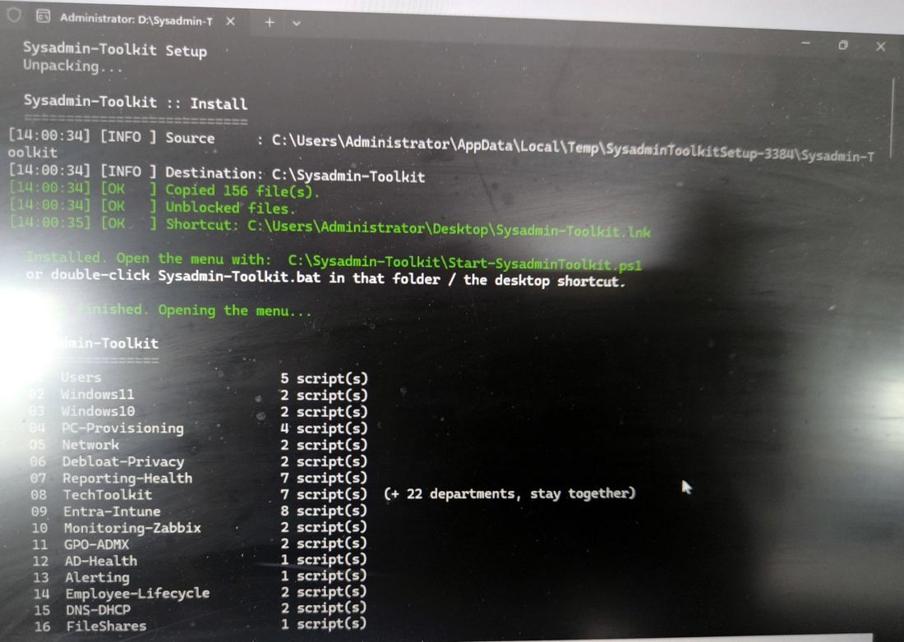
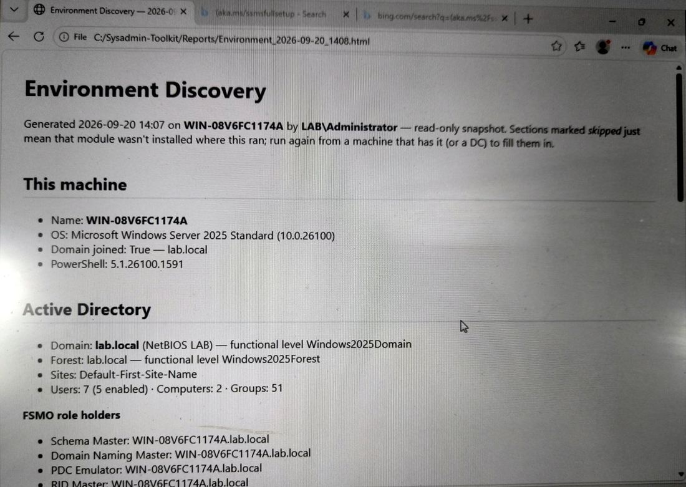
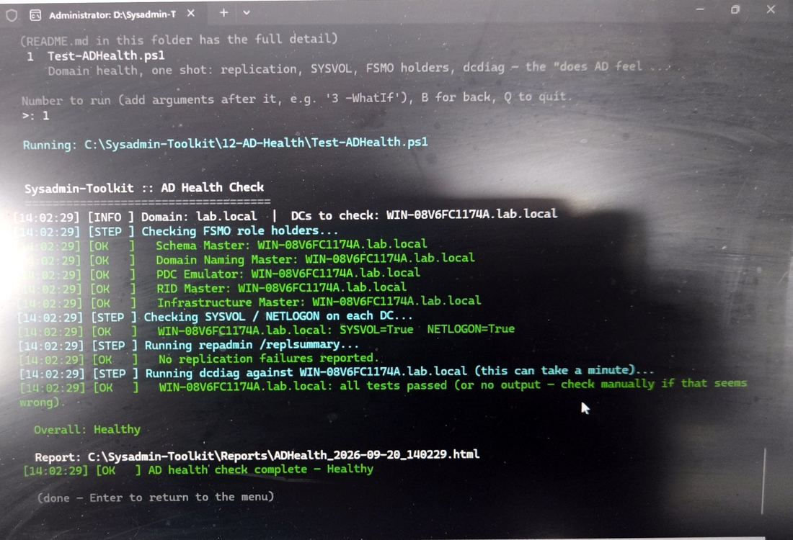

# Sysadmin-Toolkit

**Eén PowerShell-kit voor het dagelijkse werk van een Windows-systeembeheerder — van nieuwe pc tot AD-gezondheidscheck en Windows Update-beheer, in één menu of stuk voor stuk.**

Een verzameling kant-en-klare PowerShell-scripts (Windows PowerShell 5.1) voor een typische hybride Microsoft-omgeving: Windows 10/11-werkplekken, on-prem Active Directory, Entra ID + Intune in de cloud, en Zabbix-monitoring. Gebouwd en getest in een eigen lab op een echte Windows Server 2025-domeincontroller, een Windows 11-machine en een Zabbix 7.0-server.

> **Versie 1.5.9 · 21 secties · 64 scripts · installer (.exe) + ISO · draait ook vanaf USB zonder installatie.**


*Dubbelklik op de setup: de kit wordt naar `C:\Sysadmin-Toolkit` gezet, bestanden worden gedeblokkeerd, een snelkoppeling verschijnt en het menu opent.*

---

## Downloaden

| Bestand | Waarvoor |
|---|---|
| [`Sysadmin-Toolkit-Setup.exe`](Sysadmin-Toolkit-Setup.exe) | Installer — dubbelklik, installeert naar `C:\Sysadmin-Toolkit` en opent het menu |
| [`Sysadmin-Toolkit.iso`](Sysadmin-Toolkit.iso) | Dezelfde kit als ISO — mount hem of hang hem aan een VM |
| De map zelf | Kopieer naar een USB-stick en start `Sysadmin-Toolkit.bat` — geen installatie nodig |

Daarna vul je `Config\toolkit-settings.json` één keer in. Het volledige handboek staat in [`Docs/MANUAL.md`](Docs/MANUAL.md).

### Wat heb je nodig?

De scripts werken op **elke Windows 10/11-pc of Windows Server** met de standaard PowerShell 5.1 — er moet niets extra geïnstalleerd worden. Alleen wat een script aanraakt, bepaalt wat het nodig heeft:

| Scripts | Nodig |
|---|---|
| De meeste (gezondheid, inventaris, netwerk, Windows Update, desktop, branding, …) | Niets extra — werken overal |
| Active Directory, GPO, DNS/DHCP (01, 11, 12, 15) | Een domein: draaien op een domeincontroller of een pc met RSAT |
| Entra ID / Intune (09, deels 14) | Een Microsoft 365-tenant + een beheerdersaccount |
| Fleet runner (21) | PowerShell-remoting (WinRM) naar de toestellen |
| Monitoring (10) | Alleen als je Zabbix gebruikt — **Zabbix is volledig optioneel** |

---

## Wat het oplost

Een beheerder doet elke week dezelfde dingen: gebruikers aanmaken en uit dienst halen, nieuwe pc's klaarzetten, controleren of AD en DNS gezond zijn, wie lokaal admin is, welke certificaten vervallen, en welke updates er wachten. De kit maakt daar **herhaalbare, omkeerbare** stappen van: een voorvertoning (`-WhatIf`) vóór elke wijziging, een automatische back-up, en `-Rollback` om terug te zetten. Accounts worden **uitgeschakeld, nooit verwijderd.**

Eén `Config`-map vul je **één keer** in (bedrijfsnaam, OU's, shares, branding, Zabbix-server). Elk script leest die waarden zelf — dezelfde knop doet het juiste op één pc of op honderd.

---

## Wat zit erin (21 secties)

| # | Sectie | Waarvoor |
|---|---|---|
| 01 | Users | AD-onboarding/offboarding, bulk vanuit CSV, wachtwoordvervaldatum |
| 02–03 | Windows 11 / 10 | Baselines, privacy/telemetrie, Windows 11-gereedheidscheck |
| 04 | PC-Provisioning | Nieuwe pc klaarzetten, domein joinen, printers/drives, hardening |
| 05 | Network | Netwerkdiagnose, subnet-scan |
| 06 | Debloat & Privacy | Bloatware weg (met eerlijke telling: verwijderd / mislukt / overgeslagen) |
| 07 | Reporting & Health | Gescoorde gezondheidscheck, pc-inventaris, certificaat-/firewall-audit |
| 09 | Entra ID + Intune | Cloud-onboarding, compliance, LAPS, security posture (Microsoft Graph) |
| 10 | Monitoring | Zabbix-agent + template + Grafana, scripts vanuit Zabbix draaien |
| 11 | GPO / ADMX | ADMX Central Store, GPO-back-up met wijzigingsdetectie |
| 12 | AD Health | dcdiag + replicatie + FSMO + SYSVOL, gescoord |
| 13 | Alerting | Meldingen naar Teams of e-mail |
| 14 | Employee Lifecycle | Hybride in/uit-dienstflow (AD + Entra, juiste volgorde) |
| 15 | DNS / DHCP | Verouderde DNS-records, DHCP-scopebezetting |
| 16 | File Shares | Share- en NTFS-rechtenrapport |
| 17 | Security Audit | Lokale-adminaudit tegen een verwachte lijst |
| 18 | Environment Discovery | Dag-1 overzicht van een onbekende omgeving (alleen-lezen) |
| 19 | Secrets | DPAPI-versleutelde opslag van tokens/wachtwoorden |
| 20 | Desktop Experience | Branding, snelkoppelingen, regio-instellingen, energiebeleid |
| 21 | Fleet | Eén script over alle toestellen van een bedrijf draaien |
| **22** | **Windows Update** | **Pilot-ring + hold: updates eerst op één test-pc, pas daarna goedgekeurd naar de rest** |

Elk script is **standalone**: kopieer één `.ps1` naar een willekeurige pc en het draait.

*TechToolkit (de draagbare helpdesk-app met 22 departementen) is een apart project en zit niet in deze repo.*

---

## Alle scripts uitgelegd

Klik op een sectie om ze open te klappen.

- **Alleen-lezen** — kijkt alleen en maakt een rapport; verandert niets. Altijd veilig om te draaien.
- **Wijzigt** — past iets aan. Probeer altijd eerst met **`-WhatIf`**: dan zie je wat er zou gebeuren, zonder dat er iets verandert. Waar **`-Rollback`** staat, zet je de wijziging ook weer terug.

Rapporten komen terecht in `C:\Sysadmin-Toolkit\Reports\`, back-ups in `C:\Sysadmin-Toolkit\Backups\`.

<details>
<summary><b>01 — Users</b> · gebruikers aanmaken en uit dienst halen (5 scripts)</summary>

| Script | Wat het doet | Soort | Belangrijkste opties |
|---|---|---|---|
| `New-ADUserOnboard.ps1` | Maakt een nieuwe AD-gebruiker aan in één commando: loginnaam, tijdelijk wachtwoord (te wijzigen bij eerste aanmelding), groepen — of kopieer ze van een collega — functie, afdeling, manager en homedrive. | Wijzigt | `-GivenName` `-Surname` `-CopyFrom` `-Groups` `-OU` `-Department` `-Manager` |
| `Disable-ADUserOffboard.ps1` | Veilige uit-dienstflow: account **uitschakelen (nooit verwijderen)**, wachtwoord willekeurig maken, groepslijst eerst bewaren en dan de groepen weghalen, verplaatsen naar een Disabled-OU, optioneel verbergen in het adresboek. | Wijzigt | `-SamAccountName` `-HideFromGAL` `-Reason` `-Force` |
| `New-BulkADUsers.ps1` | Veel gebruikers tegelijk vanuit een CSV (instroom, seizoenskrachten). Schrijft een resultaat-CSV met de tijdelijke wachtwoorden. | Wijzigt | `-CsvPath` `-DefaultOU` |
| `Get-ADPasswordExpiry.ps1` | Lijst van accounts waarvan het wachtwoord binnenkort verloopt of al verlopen is — zodat je mensen verwittigt vóór ze buitengesloten worden. | Alleen-lezen | `-Days` `-SearchBase` |
| `Manage-LocalUser.ps1` | Lokale (niet-domein) accounts aanmaken, uitschakelen of oplijsten — voor losse pc's zonder domein. | Wijzigt | `-Action Onboard/Offboard/List` `-User` |

```powershell
.\01-Users\New-ADUserOnboard.ps1 -GivenName Anna -Surname Jansen -CopyFrom jdoe -WhatIf
.\01-Users\Disable-ADUserOffboard.ps1 -SamAccountName ajansen -HideFromGAL
```
</details>

<details>
<summary><b>02 — Windows 11</b> · standaardinstellingen en privacy (2 scripts)</summary>

| Script | Wat het doet | Soort | Belangrijkste opties |
|---|---|---|---|
| `Set-Win11Baseline.ps1` | De instellingen die je op elke nieuwe Windows 11-pc doet, per gebruiker: klassiek rechtsklikmenu terug, taakbalk en Verkenner netjes, websuggesties en Spotlight uit. | Wijzigt · `-Rollback` | `-SkipTaskbar` `-SkipExplorer` `-SkipSearch` `-SkipContextMenu` |
| `Disable-Win11AITelemetry.ps1` | Voor de hele machine: Copilot en Recall uit, telemetrie naar het minimum, reclame-ID uit. | Wijzigt · `-Rollback` | (admin nodig) |

```powershell
.\02-Windows11\Set-Win11Baseline.ps1 -WhatIf
```
</details>

<details>
<summary><b>03 — Windows 10</b> · upgrade-check en baseline (2 scripts)</summary>

| Script | Wat het doet | Soort | Belangrijkste opties |
|---|---|---|---|
| `Test-Win11Readiness.ps1` | Kan deze pc naar Windows 11? Controleert TPM, Secure Boot, UEFI, processor, geheugen en schijf, en telt af tot het einde van de Windows 10-ondersteuning. Handig om te plannen welke pc's vervangen moeten worden. | Alleen-lezen | `-OutputPath` |
| `Set-Win10Baseline.ps1` | Standaardinstellingen voor een Windows 10-werkpc: privacy, Verkenner, Cortana/Bing-zoeken uit. | Wijzigt · `-Rollback` | |

```powershell
.\03-Windows10\Test-Win11Readiness.ps1
```
</details>

<details>
<summary><b>04 — PC-Provisioning</b> · een nieuwe pc klaarzetten (4 scripts)</summary>

| Script | Wat het doet | Soort | Belangrijkste opties |
|---|---|---|---|
| `Initialize-NewPC.ps1` | "Nieuwe pc uit de doos": naam geven, energieschema, Extern bureaublad aan, standaardsoftware installeren via winget, tijdzone, update-scan. | Wijzigt | `-NewName` `-Apps` `-EnableRDP` `-TimeZone` |
| `Join-Domain.ps1` | Zet de pc in het domein, optioneel met nieuwe naam en meteen in de juiste OU, zodat de juiste GPO's direct gelden. | Wijzigt | `-Domain` `-NewName` `-OUPath` `-Restart` |
| `Setup-PrintersAndDrives.ps1` | Koppelt netwerkschijven en printers vanuit een lijstje bovenaan het script — zonder GPO. Opnieuw draaien is veilig. | Wijzigt | (lijst in het script) |
| `Harden-Baseline.ps1` | Voorzichtige beveiligingsbasis voor een losse pc zonder GPO; maakt eerst een back-up. | Wijzigt · `-Rollback` | `-BackupPath` |

```powershell
.\04-PC-Provisioning\Initialize-NewPC.ps1 -NewName PC-SALES-07 -EnableRDP -WhatIf
.\04-PC-Provisioning\Join-Domain.ps1 -Domain lab.local -OUPath "OU=Workstations,DC=lab,DC=local" -Restart
```
</details>

<details>
<summary><b>05 — Network</b> · netwerkproblemen opsporen (2 scripts)</summary>

| Script | Wat het doet | Soort | Belangrijkste opties |
|---|---|---|---|
| `Get-NetworkDiagnostics.ps1` | Alles wat je controleert bij een ticket "geen internet / traag / server onbereikbaar": netwerkkaarten, gateway, DNS, internet, publiek IP — en waar het misloopt — in één HTML-rapport. | Alleen-lezen | `-TargetHosts` |
| `Invoke-SubnetScan.ps1` | Scant een netwerk: welke toestellen zijn er, hun namen en MAC-adressen, optioneel open poorten → CSV/HTML. | Alleen-lezen | `-Subnet` `-Ports` |

```powershell
.\05-Network\Get-NetworkDiagnostics.ps1 -TargetHosts server1,192.168.1.1
```
</details>

<details>
<summary><b>06 — Debloat & Privacy</b> · overbodige apps en opstartprogramma's (2 scripts)</summary>

| Script | Wat het doet | Soort | Belangrijkste opties |
|---|---|---|---|
| `Remove-Bloatware.ps1` | Verwijdert vooraf geïnstalleerde apps van een **veilige lijst**. Standaard toont het alleen wat het zou doen; pas met `-Execute` wordt er echt verwijderd. Eindigt met een eerlijke telling: verwijderd / mislukt / overgeslagen. | Wijzigt (met `-Execute`) | `-List` `-Execute` `-Keep` `-Extra` `-AllUsers` |
| `Get-StartupItems.ps1` | Toont alles wat bij het opstarten meestart (Run-sleutels, Opstartmap, taken) — de snelle "waarom start deze pc zo traag op". Kan één item omkeerbaar uitschakelen. | Alleen-lezen (tenzij `-Disable`) | `-Disable` |

```powershell
.\06-Debloat-Privacy\Remove-Bloatware.ps1            # toont alleen
.\06-Debloat-Privacy\Remove-Bloatware.ps1 -Execute   # verwijdert echt
```
</details>

<details>
<summary><b>07 — Reporting & Health</b> · dagelijkse rapporten (7 scripts)</summary>

| Script | Wat het doet | Soort | Belangrijkste opties |
|---|---|---|---|
| `Invoke-HealthCheck.ps1` | Dagelijkse gezondheidscheck van een pc of server: schijf, geheugen, belangrijke diensten, herstart nodig, updates, uptime, fouten, Defender → gescoord HTML-rapport + trend, optioneel per e-mail. | Alleen-lezen | `-EmailTo` `-SmtpServer` `-Services` |
| `Install-HealthCheckTask.ps1` | Plant die gezondheidscheck elke dag automatisch in (als SYSTEM). `-Remove` haalt hem weer weg. | Wijzigt | `-At` `-Remove` |
| `Get-PCInventory.ps1` | Volledige inventaris van een pc: hardware, Windows, schijven, netwerk, software, BitLocker, activatie → HTML + CSV. | Alleen-lezen | `-OutputPath` |
| `Get-CertExpiryReport.ps1` | Certificaten die verlopen zijn of binnenkort verlopen (RDP, interne web-/app-sites, LDAPS) — vóór ze een storing veroorzaken. | Alleen-lezen | `-WarningDays` `-ComputerName` |
| `Get-FirewallAuditReport.ps1` | Firewallprofielen, toegestane inkomende regels en wat er écht luistert, met markering van risicovolle poorten. | Alleen-lezen | `-ComputerName` `-FlagPorts` |
| `Get-SoftwareInventoryReport.ps1` | Software over alle machines heen: wat staat er, op hoeveel pc's, en wat is al lang niet meer ondersteund (end-of-life). | Alleen-lezen | `-ComputerName` `-FlaggedOnly` |
| `Confirm-BitLockerEscrow.ps1` | Staan de BitLocker-herstelsleutels echt bewaard in AD en/of Entra? Vindt het vóór iemand buitengesloten wordt. | Alleen-lezen | `-ComputerName` |

```powershell
.\07-Reporting-Health\Invoke-HealthCheck.ps1
.\07-Reporting-Health\Get-CertExpiryReport.ps1 -WarningDays 30
```
</details>

<details>
<summary><b>09 — Entra ID + Intune</b> · de cloudkant via Microsoft Graph (8 scripts)</summary>

| Script | Wat het doet | Soort | Belangrijkste opties |
|---|---|---|---|
| `New-EntraUserOnboard.ps1` | Nieuwe gebruiker rechtstreeks in Entra ID (cloud): tijdelijk wachtwoord, land, licenties, groepen, manager. | Wijzigt | `-UserPrincipalName` `-UsageLocation` `-LicenseSkuIds` `-Groups` |
| `Disable-EntraUserOffboard.ps1` | Uit dienst in de cloud: aanmelden blokkeren, actieve sessies beëindigen, licenties en groepen weghalen, optioneel het Intune-toestel uit beheer halen. | Wijzigt | `-UserPrincipalName` `-WipeDevices` |
| `Get-IntuneDeviceCompliance.ps1` | Compliance van alle Intune-toestellen in één rapport: voldoet / voldoet niet, verouderd, versleuteling. | Alleen-lezen | `-NonCompliantOnly` `-StaleDays` |
| `Get-IntunePatchCompliance.ps1` | Welke toestellen achterlopen op Windows-versie, vergeleken met de rest van je eigen vloot. | Alleen-lezen | `-ThresholdBuilds` |
| `Get-LAPSComplianceReport.ps1` | Wordt het lokale beheerderswachtwoord (LAPS) echt geroteerd en bewaard, op elk toestel? | Alleen-lezen | `-StaleDays` |
| `Get-EntraSecurityPosture.ps1` | Overzicht van de Conditional Access-regels en wie vaste beheerdersrollen heeft. | Alleen-lezen | |
| `Deploy-ScriptViaIntune.ps1` | Duwt elk script uit deze kit via Intune naar een groep toestellen — zonder GPO en zonder elke pc te bezoeken. | Wijzigt | `-ScriptPath` `-GroupName` |
| `New-IntuneConfigProfile-Win11Baseline.ps1` | Zet de Windows 11 AI-/telemetrie-instellingen als echt, centraal beheerd Intune-beleid. | Wijzigt | `-GroupName` |

```powershell
.\09-Entra-Intune\Get-IntuneDeviceCompliance.ps1 -NonCompliantOnly
```
</details>

<details>
<summary><b>10 — Monitoring (Zabbix + Grafana)</b> · bewaking en knoppen in Zabbix (3 scripts)</summary>

| Script | Wat het doet | Soort | Belangrijkste opties |
|---|---|---|---|
| `Install-ZabbixAgent.ps1` | Installeert en configureert Zabbix Agent 2 en koppelt meteen de toolkit-metingen, zodat de pc in Zabbix en Grafana verschijnt. | Wijzigt | `-InstallerPath` `-ServerIP` `-ServerActiveIP` |
| `New-ZabbixToolkitScripts.ps1` | Maakt in één keer de "Toolkit: …"-knoppen in Zabbix via de API, zodat je vanuit de monitoring een script op een toestel start. `-Folder` zet een hele sectie (alleen de veilige, alleen-lezen scripts) als knoppen. | Wijzigt (in Zabbix) | `-ZabbixUrl` `-ApiToken` `-Folder` `-HostGroup` `-Remove` |
| `UserParameters\Get-ToolkitZabbixMetrics.ps1` | Geeft de gezondheid van de pc als één regel JSON aan Zabbix: schijf, geheugen, herstart, Defender, wachtende updates, laatste patch, kit-versie. | Alleen-lezen | |

Ook in deze map: een kant-en-klaar **Zabbix-template** en een **Grafana-dashboard**.
</details>

<details>
<summary><b>11 — GPO / ADMX</b> · groepsbeleid (2 scripts)</summary>

| Script | Wat het doet | Soort | Belangrijkste opties |
|---|---|---|---|
| `Deploy-GPOCentralStore.ps1` | Pakt het ADMX-pakket van Microsoft uit en plaatst het in de Central Store (SYSVOL), zodat elke beheerder dezelfde, actuele beleidsinstellingen ziet. Maakt eerst een back-up. | Wijzigt | `-SourceMsi` |
| `Backup-GPOs.ps1` | Back-up van elke GPO + een HTML-rapport per GPO, en meldt welke GPO's veranderd zijn sinds de vorige keer. | Maakt back-ups | `-SkipReport` |

```powershell
.\11-GPO-ADMX\Backup-GPOs.ps1
```
</details>

<details>
<summary><b>12 tot 19</b> · AD-gezondheid, meldingen, in/uit dienst, DNS/DHCP, shares, beveiliging, omgevingsscan, geheimen (10 scripts)</summary>

| Sectie | Script | Wat het doet | Soort |
|---|---|---|---|
| 12 | `Test-ADHealth.ps1` | Eén check of Active Directory gezond is: replicatie, SYSVOL, FSMO-rollen, dcdiag → gescoord rapport. Het eerste wat je draait als er iets mis lijkt. | Alleen-lezen |
| 13 | `Send-ToolkitAlert.ps1` | Stuurt één melding naar Teams en/of e-mail. Andere scripts gebruiken dit om alarm te slaan. | Verstuurt bericht |
| 14 | `New-EmployeeOnboard.ps1` | Hybride indienst in één commando: AD-account → wachten tot het in Entra staat → licenties en cloudgroepen. In de juiste volgorde. | Wijzigt |
| 14 | `Disable-EmployeeOffboard.ps1` | Hybride uitdienst: eerst de cloudtoegang afsluiten, dan AD — zodat niets op synchronisatie moet wachten. | Wijzigt |
| 15 | `Get-DHCPScopeReport.ps1` | Hoe vol zit elke DHCP-scope — waarschuwt vóór "niemand krijgt nog een IP-adres". | Alleen-lezen |
| 15 | `Get-StaleDNSRecords.ps1` | DNS-records die niet meer antwoorden en bij geen actieve computer horen. Enkel een rapport; verwijderen is een aparte, bewuste stap. | Alleen-lezen |
| 16 | `Get-SharePermissionReport.ps1` | Wie mag wat op de bestandsshares (share- én NTFS-rechten), plus oude "verweesde" rechten die nooit opgekuist werden. | Alleen-lezen |
| 17 | `Get-LocalAdminAudit.ps1` | Wie zit er écht in de lokale Administrators-groep, op één of meer pc's, vergeleken met wie er hoort te zitten. | Alleen-lezen |
| 18 | `Get-EnvironmentDiscovery.ps1` | Brengt een onbekende omgeving in kaart: domein, servers, OU's, GPO's, DHCP, DNS, shares, optioneel Intune → één document. Het dag-1-script. | Alleen-lezen |
| 19 | `Manage-ToolkitSecret.ps1` | Bewaart kleine geheimen (webhook, API-token, SMTP-wachtwoord) versleuteld, zodat ze nooit leesbaar in een script of config staan. | Bewaart geheim |

```powershell
.\12-AD-Health\Test-ADHealth.ps1
.\17-Security-Audit\Get-LocalAdminAudit.ps1 -ComputerName PC01,PC02
.\18-Environment-Discovery\Get-EnvironmentDiscovery.ps1
```
</details>

<details>
<summary><b>20 — Desktop Experience</b> · de werkplek er professioneel laten uitzien (7 scripts)</summary>

| Script | Wat het doet | Soort |
|---|---|---|
| `Set-Branding.ps1` | Bedrijfsachtergrond en vergrendelscherm voor alle gebruikers, en de supportgegevens (telefoon, uren, website) in Instellingen → Info. | Wijzigt · `-Rollback` |
| `Set-DesktopExperience.ps1` | Thema, bureaubladpictogrammen, weergave in Verkenner, Snelle toegang, tips en reclame uit. | Wijzigt · `-Rollback` |
| `New-DesktopShortcuts.ps1` | Standaard snelkoppelingen op het bureaublad (apps, shares, webportalen) vanuit een eenvoudige lijst. | Wijzigt · `-Remove` |
| `Set-StartTaskbarLayout.ps1` | Welke apps vastgemaakt staan in Start en op de taakbalk, voor nieuwe en (waar Windows het toelaat) bestaande gebruikers. | Wijzigt · `-Rollback` |
| `Add-ContextMenuEntries.ps1` | Handige rechtsklikopties: PowerShell hier (ook als beheerder), pad kopiëren, openen met Kladblok, eigenaar worden. | Wijzigt · `-Remove` |
| `Set-RegionalSettings.ps1` | Belgische regio-instellingen in één keer: taal en notatie, toetsenbord, tijdzone, datumnotatie — optioneel ook voor het aanmeldscherm en nieuwe gebruikers. | Wijzigt · `-Rollback` |
| `Set-PowerAndLock.ps1` | Energie en vergrendelen: scherm uit, slaapstand, automatisch vergrendelen, deksel en aan-knop; kant-en-klare instellingen `-Workstation` en `-Laptop`. | Wijzigt · `-Rollback` |

```powershell
.\20-Desktop-Experience\Set-Branding.ps1 -WhatIf
.\20-Desktop-Experience\Set-PowerAndLock.ps1 -Laptop
```
</details>

<details>
<summary><b>21 — Fleet</b> · één script op alle toestellen van een bedrijf (2 scripts)</summary>

| Script | Wat het doet | Soort | Belangrijkste opties |
|---|---|---|---|
| `Get-ManagedFleet.ps1` | Lijst van de toestellen van een bedrijf, uit Zabbix — met AD en Intune als terugval. | Alleen-lezen | `-Company` `-OS` `-OnlineOnly` |
| `Invoke-ToolkitFleet.ps1` *(in de hoofdmap)* | Draait één kit-script op alle toestellen van een bedrijf tegelijk en geeft één rapport: gelukt / offline / mislukt. `-WhatIf` toont eerst op welke toestellen het zou draaien. | Wijzigt (wat het gekozen script doet) | `-Company` `-Computers` `-Script` `-OS` |

```powershell
.\Invoke-ToolkitFleet.ps1 -Company Contoso -Script "17-Security-Audit\Get-LocalAdminAudit.ps1" -WhatIf
```
</details>

<details>
<summary><b>22 — Windows Update</b> · eerst testen op één pc, dan goedkeuren (3 scripts)</summary>

| Script | Wat het doet | Soort | Belangrijkste opties |
|---|---|---|---|
| `Get-UpdateStatus.ps1` | Welke updates wachten (beveiligingsupdates apart), wanneer de pc laatst gepatcht werd en of hij op hold staat. Als rapport of als JSON. | Alleen-lezen | `-Json` |
| `Set-UpdatePolicy.ps1` | Kies per pc: **Pilot** (installeert updates meteen — je test-pc), **Hold** (downloadt maar installeert niets zelf, en vergrendelt *Instellingen → Windows Update*) of **Default** (geeft updates terug aan Windows). Nooit een herstart terwijl er iemand aangemeld is. | Wijzigt | `-Mode Pilot/Hold/Default` |
| `Install-ApprovedUpdates.ps1` | Installeert alleen de updates die jij goedkeurde, verbergt de afgewezen, herstart nooit zelf. Draait als achtergrondtaak, zodat een lange installatie nooit halverwege wordt afgebroken. | Wijzigt | `-UpdateId` `-Hide` |

```powershell
.\22-Windows-Update\Set-UpdatePolicy.ps1 -Mode Pilot     # op de test-pc
.\22-Windows-Update\Set-UpdatePolicy.ps1 -Mode Hold      # op alle andere pc's
.\22-Windows-Update\Get-UpdateStatus.ps1
```
</details>

<details>
<summary><b>Hoofdmap</b> · menu, installatie en tests</summary>

| Bestand | Wat het doet |
|---|---|
| `Sysadmin-Toolkit.bat` / `Start-SysadminToolkit.ps1` | Het menu: kies een sectie, kies een script. Typ alleen het nummer en je ziet eerst wat het script doet en welke opties het heeft. |
| `Install-Toolkit.ps1` | Installeert de kit naar `C:\Sysadmin-Toolkit` met een snelkoppeling. `-Prune` verplaatst bestanden van een oudere versie naar `Backups\` (nooit verwijderd). |
| `Install-AllScheduledTasks.ps1` | Plant alle terugkerende rapporten (gezondheid, AD, wachtwoorden, certificaten) in één keer in. |
| `Tests\Run-Tests.ps1` | Controleert dat elk script klopt en veilig blijft, vóór het op een echte machine komt. |
</details>

---

## Nieuw: Windows Update met een pilot-ring (sectie 22)

Microsofts maandelijkse updates zijn meestal goed — en soms breken ze printen, VPN of een bedrijfsapplicatie. Sectie 22 zorgt dat een slechte update **één test-pc** raakt in plaats van alle pc's:

- **`Get-UpdateStatus.ps1`** — welke updates wachten (beveiliging apart gemarkeerd), datum van de laatste echte patch, hold-status. Alleen-lezen; levert ook de cijfers voor Zabbix.
- **`Set-UpdatePolicy.ps1 -Mode Pilot | Hold | Default`** — *Pilot*: installeert meteen. *Hold*: downloadt maar installeert niets zelf, en vergrendelt *Instellingen → Windows Update* zodat niemand toch op "Installeren" klikt. Nooit een herstart terwijl er iemand ingelogd is; Defender-handtekeningen blijven zelf binnenkomen.
- **`Install-ApprovedUpdates.ps1`** — installeert exact de goedgekeurde updates (als achtergrondtaak, wordt nooit halverwege afgebroken), verbergt de afgewezen, herstart nooit zelf.

---

## Getest op een echt lab

**Omgevingsscan en AD-gezondheid op de domeincontroller:**




Live bewezen:

- **Automatisch draaien (`-Force`)** — zonder bevestigingsvraag, geschikt voor geplande taken.
- **Zabbix-knoppen** — "Toolkit: …"-knoppen aangemaakt via de Zabbix-API; draaien op de host.
- **Fleet runner** — één script van de domeincontroller over een Windows 11-machine (WinRM): `1 done, 0 failed, 0 offline`.
- **Windows 11-machine volledig aan Zabbix toegevoegd** — agent → host → knoppen.
- **Windows Update-sectie** in het veld getest; de gevonden problemen (o.a. de Instellingen-knop op een gehouden pc) staan opgelost in [`CHANGELOG.md`](CHANGELOG.md).

---

## Veiligheid

- **`-WhatIf`** op elk wijzigend script — toont wat het *zou* doen, verandert niets.
- **Back-up vóór elke wijziging** + **`-Rollback`** om terug te zetten.
- **Bevestiging** bij destructieve acties; **`-Force`** om dat over te slaan bij automatisatie.
- **Rapporteren, niet verwijderen** — accounts uitgeschakeld, verouderde records gemarkeerd; echt verwijderen is altijd een aparte, bewuste stap.
- **Updates bij `-Prune`**: oude bestanden worden verplaatst naar `Backups\Pruned-<datum>\`, nooit verwijderd.

---

## Documentatie

- [`Docs/MANUAL.md`](Docs/MANUAL.md) — het handboek.
- [`Docs/Command-Reference.md`](Docs/Command-Reference.md) — alle commando's per taak.
- Per sectie een eigen `README.md` met uitgewerkte voorbeelden.
- [`README-EN.md`](README-EN.md) — de uitgebreide technische introductie (Engels).
- [`CHANGELOG.md`](CHANGELOG.md) — wat er per versie veranderde.

---

## Techniek

Windows PowerShell **5.1** (staat op elke Windows-machine — geen PowerShell 7 nodig), UTF-8 met BOM, en een testset die controleert dat elk script parset, 5.1-compatibel is en dat risicovolle scripts `-WhatIf` behouden. De installer is zelf-uitpakkend, zonder externe afhankelijkheden.

---

## Auteur

**Stojan Tomeski**
stojantomeski.be · linkedin.com/in/stojan-t-38531368

*Gemaakt en getest in een eigen lab (`lab.local` op Windows Server 2025, een Windows 11-machine en Zabbix 7.0). Er staan geen gegevens van klanten of werkgevers in.*
